<a href="README.md">IT</a> · <b>EN</b>

### Stack

## Three disciplines, *one system.*

Analysis, engineering and real time aren't separate departments: they're the same data at three moments.

<table>
<tr>
<td width="33%" valign="top">

`01`
### [Data Analytics](https://ginnytech.it/en/course/significativita-statistica/)
***The right questions, defensible metrics.***

KPI trees, experimentation, attribution and causal inference. Numbers that hold up in front of a board.

`A/B tests` `MMM` `cohorts`

</td>
<td width="33%" valign="top">

`02`
### [Analytics Engineering](https://ginnytech.it/en/course/analytics-engineering/)
***Data treated as code.***

Tested dbt models, data contracts and a semantic layer. Every metric has a definition, an owner, a history.

`dbt` `data contracts` `CI/CD`

</td>
<td width="33%" valign="top">

`03`
### [Real-time Analytics](https://ginnytech.it/en/course/real-time-analytics/)
***Seconds, not days.***

Streaming with Kafka, high-throughput ingestion and materialized views on ClickHouse. Alerts when it happens, not after.

`Kafka` `ClickHouse` `CDC`

</td>
</tr>
</table>

## From event to decision.

## Certifications, *verified by the vendors of the stack I use.*

| Issuer | Other certifications | Year |
|---|---|---|
| Databricks | Azure Databricks Platform Architect | 2025 · valid until 2027 |
| Anthropic | Building with the Claude API | 2026 |
| HackerRank | SQL Advanced | 2025 |
| ClickHouse | ClickHouse Developer Course | 2025 |
| Uplimit | Data Storytelling | 2025 |

[All certifications on LinkedIn ↗](https://www.linkedin.com/in/andrii-dyshkantiuk/details/certifications/)

## Principles

> **Latency is a business decision.**
> Real time where it changes a decision, batch where that's enough. Cost follows value.

> **Every number is reproducible.**
> Versioned, tested, documented. If a metric changes, you know where and why.

> **The question first, then the stack.**
> Tools change. A data model built around decisions stays.

## Let's work together

<table>
<tr>
<td width="50%" valign="top">

`FOR COMPANIES AND TEAMS`
### Architecture, audits, real-time pipelines.

I design or clean up the analytics stack, bring data into real time and train the team to run it.

**[Book a call →](https://ginnytech.it/en/contact/)**

</td>
<td width="50%" valign="top">

`FOR LEARNERS`
### The course, open and free.

The same method I use on client projects, from tracking to agentic AI. Public code on GitHub.

**[Start the path →](https://ginnytech.it/en/#corsi)** · [Course repo ↗](https://github.com/AndreyBertasini/gynnitech)

</td>
</tr>
</table>

---

<h3 align="center"><i>Does your data arrive before your decisions?</i></h3>

