<b>IT</b> · <a href="README.en.md">EN</a>

### Stack

## Tre discipline, *un solo sistema.*

Analisi, ingegneria e tempo reale non sono reparti separati: sono lo stesso dato in tre momenti.

<table>
<tr>
<td width="33%" valign="top">

`01`
### [Data Analytics](https://ginnytech.it/course/significativita-statistica/)
***Domande giuste, metriche difendibili.***

KPI tree, sperimentazione, attribuzione e inferenza causale. Numeri che reggono davanti a un board.

`A/B test` `MMM` `coorti`

</td>
<td width="33%" valign="top">

`02`
### [Analytics Engineering](https://ginnytech.it/course/analytics-engineering/)
***Il dato trattato come codice.***

Modelli dbt testati, data contract e semantic layer. Ogni metrica ha una definizione, un proprietario, una storia.

`dbt` `data contract` `CI/CD`

</td>
<td width="33%" valign="top">

`03`
### [Real-time Analytics](https://ginnytech.it/course/real-time-analytics/)
***Secondi, non giorni.***

Streaming con Kafka, ingestion ad alto throughput e materialized view su ClickHouse. Alert quando succede, non dopo.

`Kafka` `ClickHouse` `CDC`

</td>
</tr>
</table>

## Dall'evento alla decisione.

## Certificazioni, *verificate dai vendor dello stack che uso.*

| Ente | Altre certificazioni | Anno |
|---|---|---|
| Databricks | Azure Databricks Platform Architect | 2025 · valida fino 2027 |
| Anthropic | Building with the Claude API | 2026 |
| HackerRank | SQL Advanced | 2025 |
| ClickHouse | ClickHouse Developer Course | 2025 |
| Uplimit | Data Storytelling | 2025 |

[Tutte le certificazioni su LinkedIn ↗](https://www.linkedin.com/in/andrii-dyshkantiuk/details/certifications/)

## Principi

> **La latenza è una scelta di business.**
> Real-time dove cambia una decisione, batch dove basta. Il costo segue il valore.

> **Ogni numero è riproducibile.**
> Versionato, testato, documentato. Se una metrica cambia, si sa dove e perché.

> **Prima la domanda, poi lo stack.**
> Gli strumenti cambiano. Un modello dati costruito attorno alle decisioni resta.

## Collaboriamo

<table>
<tr>
<td width="50%" valign="top">

`PER AZIENDE E TEAM`
### Architettura, audit, pipeline real-time.

Disegno o rimetto in ordine lo stack analytics, porto i dati in tempo reale e formo il team perché lo sappia gestire.

**[Richiedi una call →](https://ginnytech.it/contact/)**

</td>
<td width="50%" valign="top">

`PER CHI STUDIA`
### Il corso, aperto e gratuito.

Lo stesso metodo che uso sui progetti, dal tracking all'agentic AI. Codice pubblico su GitHub.

**[Inizia il percorso →](https://ginnytech.it/#corsi)** · [Repo del corso ↗](https://github.com/AndreyBertasini/gynnitech)

</td>
</tr>
</table>

---

<h3 align="center"><i>I tuoi dati arrivano prima delle tue decisioni?</i></h3>

