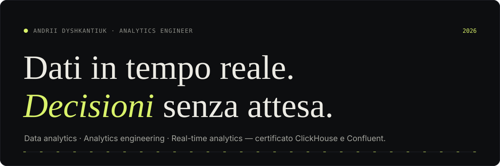

<table>
<tr>
<td width="62%" valign="top">

Progetto sistemi di **data analytics**, **analytics engineering** e **real-time analytics** per team che non possono aspettare il report di domani. Certificato **ClickHouse** e **Confluent**.

| | |
|---|---|
| **Esperienza** | 15+ anni tra dati, marketing e prodotto |
| **Certificazione** | ClickHouse Certified Developer · Confluent Data Streaming Engineer |
| **Specializzazione** | Real-time: streaming, OLAP, aggregazioni continue |
| **Stack** | Kafka · dbt · ClickHouse · SQL · Python · S3 / Iceberg |

</td>
<td width="38%" valign="top">

</td>
</tr>
</table>

## Tre discipline, *un solo sistema.*

Analisi, ingegneria e tempo reale non sono reparti separati: sono lo stesso dato in tre momenti.

| `01` [Data Analytics](https://ginnytech.it/course/significativita-statistica/) | `02` [Analytics Engineering](https://ginnytech.it/course/analytics-engineering/) | `03` [Real-time Analytics](https://ginnytech.it/course/real-time-analytics/) |
|---|---|---|
| ***Domande giuste, metriche difendibili.*** | ***Il dato trattato come codice.*** | ***Secondi, non giorni.*** |
| KPI tree, sperimentazione, attribuzione e inferenza causale. Numeri che reggono davanti a un board. | Modelli dbt testati, data contract e semantic layer. Ogni metrica ha una definizione, un proprietario, una storia. | Streaming con Kafka, ingestion ad alto throughput e materialized view su ClickHouse. Alert quando succede, non dopo. |
| `A/B test · MMM · coorti` | `dbt · data contract · CI/CD` | `Kafka · ClickHouse · CDC` |

## Dall'evento alla decisione.

## Certificazioni — *verificate dai vendor dello stack che uso.*

**ClickHouse Certified Developer** · ClickHouse, Inc. · Nov 2026 · [Verifica ↗](https://ginnytech.it/certificati/clickhouse-certified-developer.pdf)
Esame pratico ufficiale: modellazione MergeTree, performance delle query, ingestion ad alto throughput, OLAP in tempo reale.

**Data Streaming Engineer** · Confluent, an IBM Company · Gen 2026 · [Verifica ↗](https://certificates.confluent.io/e04ee5d4-7d17-42bd-8661-57ab361da18b)

| Area | Punteggio |
|---|---|
| Apache Kafka | `██████████` 100% |
| Kafka Connect | `██████████` 100% |
| Kafka Streams | `██████████` 100% |
| Schema Registry | `██████████` 100% |
| Apache Flink | `█████████░` 88% |

<b>Altre certificazioni</b>

| Ente | Certificazione | Anno |
|---|---|---|
| Databricks | Azure Databricks Platform Architect | 2025 · valida fino 2027 |
| Anthropic | Building with the Claude API | 2026 |
| HackerRank | SQL Advanced | 2025 |
| ClickHouse | ClickHouse Developer Course | 2025 |
| Uplimit | Data Storytelling | 2025 |

[Tutte le certificazioni su LinkedIn ↗](https://www.linkedin.com/in/andrii-dyshkantiuk/details/certifications/)

## Principi

> **La latenza è una scelta di business.**
> Real-time dove cambia una decisione, batch dove basta. Il costo segue il valore.

> **Ogni numero è riproducibile.**
> Versionato, testato, documentato. Se una metrica cambia, si sa dove e perché.

> **Prima la domanda, poi lo stack.**
> Gli strumenti cambiano. Un modello dati costruito attorno alle decisioni resta.

## Collaboriamo

| **Per aziende e team** | **Per chi studia** |
|---|---|
| ***Architettura, audit, pipeline real-time.*** | ***Il corso, aperto e gratuito.*** |
| Disegno o rimetto in ordine lo stack analytics, porto i dati in tempo reale e formo il team perché lo sappia gestire. | Lo stesso metodo che uso sui progetti, dal tracking all'agentic AI. Codice pubblico su GitHub. |
| [Richiedi una call →](https://ginnytech.it/contact/) | [Inizia il percorso →](https://ginnytech.it/#corsi) · [Repo del corso ↗](https://github.com/AndreyBertasini/gynnitech) |

---

<i>I tuoi dati arrivano prima delle tue decisioni?</i> &nbsp; <a href="https://ginnytech.it/contact/"><b>Parliamone →</b></a>

